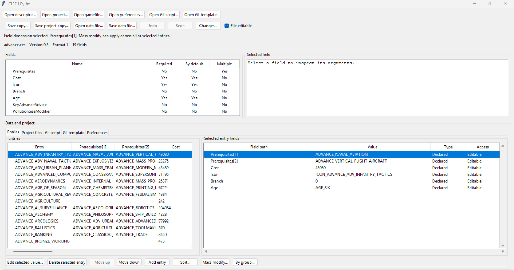

# CTPEd

Open Call to Power 2 game files, inspect their records, and edit individual values or apply bulk transformations. Preview your changes and save an edited copy when you are ready.

[Download for Windows](releases/CTPEdPython-Windows-x64.zip) · [Start editing](#start-editing) · [Available edits](#available-edits) · [Excel and CLI](#automate-with-excel-and-cli) · [Development](#development-and-reference)

## See the editor



*The Windows executable with `Advance.txt` imported: Entries on the left, the selected Entry's editable fields on the right, and editing controls below.*

## Start editing

### 1. Download and launch

1. Download the [Windows x64 distribution](releases/CTPEdPython-Windows-x64.zip).
2. Extract the archive and keep the extracted folder together.
3. Run `CTPEdPython/CTPEdPython.exe`.

The folder includes the Python and Tcl/Tk runtime, the default `.ced` template, and the `Structure` descriptors.

### 2. Open a gamefile and import a file

1. Choose **Open gamefile…** and select your game's or mod's `gamefile.txt` or prefixed `*_gamefile.txt`.

   The Windows package supplies the descriptors; you do not need to locate a separate `.ced` file. Opening the gamefile lists the project's files without importing all their data.

2. In **Project files**, select a data file such as `Advance.txt`.
3. Choose **Import selected file**.

   If a file or descriptor cannot be found, use **Check paths** to inspect the resolved locations.

### 3. Edit, review, and save a copy

1. In **Entries**, select a record to see its fields and values.
2. Select an editable value and choose **Edit selected value…**, or use **Mass modify…** for bulk changes.
3. Choose **Changes…** to review the diff; use **Undo** or **Redo** to revise your edits.
4. Choose **Save data file…** and save to a separate destination.

Edits stay in memory until you choose a save destination. Unsupported schemas or edits produce an error.

## Available edits

### Records and values

| Task | How to do it |
| --- | --- |
| Change a field | Select a scalar value such as `Cost`, `Icon`, or `Prerequisites`, then choose **Edit selected value…**. |
| Apply a bulk edit | Use **Mass modify…** to set, concatenate, add, multiply, or apply a formula; preview the results before applying. Formulas can reference same-file Entries or project data. |
| Apply grouped multipliers | Use **By group…** to group Entries by field values and preview the resulting transformation. |
| Manage Entries | Add an Entry with descriptor defaults, delete selected Entries, reorder them, or sort them. Nested defaults are included when child descriptors are available. |
| Edit nested values | Edit scalar values defined by a child descriptor; when that descriptor is unavailable, edit the complete raw nested block. Raw blocks are excluded from scalar mass edits. |
| Review or reverse changes | Use **Changes…** for the source diff and **Ctrl+Z / Ctrl+Y** for undo/redo, with up to 50 edits in the active data or settings document. |
| Edit direct text | Format-0/2 files support text editing and exact replacement; format-0 numeric records also support numeric mass edits. |

To target a subset, select the required Entry rows before a selected-only mass edit. Focus the Entries matrix and press **Ctrl+A** to select every Entry; use its scrollbars to reach all rows and fields.

Editing support depends on the file format and descriptor. Format-1/3 files expose structured Entries; read-only or unsupported values remain unavailable for editing.

### Projects and supporting files

| File | What you can inspect or edit |
| --- | --- |
| `.ced` project | Inspect declarations, choose data and structure roots and language, check paths, and import one declaration at a time. |
| `.ces` descriptor | Inspect fields, flags, defaults, and argument definitions; open a matching data file through **Open data file…**. |
| `.prf` preferences | Inspect and edit the supported preferences. |
| `.gls` / `.glt` Great Library files | Edit scripts or templates, preview supported template directives, and save a selected Entry render as a CP1252 text copy; the unit-icon name-template preview supports `%n`. |

Use the corresponding save-copy action for descriptors, projects, preferences, scripts, and templates.

## Automate with Excel and CLI

Use workbooks to define repeatable transformations and compare CTPEd's results with values already calculated by Excel.

```text
Mapped inputs and rules -> CTPEd transformations -> Excel expectation check -> output overlay
```

### Prepare the workbooks

1. Define the operations in a workbook's **Rules** sheet.
2. Put the expected results in a separate workbook's **CTPEdQA** sheet.
3. Recalculate and save the QA workbook in Excel so its formula results are cached.

CTPEd applies its own transformation formulas and reads Excel's cached results for comparison. A QA mismatch prevents the command from publishing an overlay.

See the [workbook reference and template downloads](docs/transform_api_spec.md#workbooks) for the required columns and supported operations.

### Run a transformation

1. From this repository's folder, create an environment and install the automation dependencies:

   ```powershell
   python -m venv .venv
   .venv\Scripts\python.exe -m pip install -r requirements-api.txt
   ```

2. Place your rules and QA workbooks in this folder. Extract the Windows distribution here as `CTPEdPython` to supply its `default.ced` and `Structure` folder.
3. Run the command below, replacing the gamefile path and workbook names with your own:

   ```powershell
   .venv\Scripts\python.exe src/transform_api.py apply `
     --rules-workbook rules.xlsx `
     --qa-workbook expected.xlsx `
     --gamefile "C:\Games\Call To Power 2\ctp2_data\default\gamedata\gamefile.txt" `
     --template CTPEdPython/default.ced `
     --structure-root CTPEdPython/Structure `
     --output-directory ctpedit-overlay
   ```

Choose a new output directory outside the source data root. On success, it contains only changed files at their relative paths; your original game files are preserved. A QA mismatch exits nonzero and creates no output directory. A mod generator can consume this overlay as a later publication step.

For HTTP clients, see [starting the optional local service](docs/transform_api_spec.md#start-the-http-service) and its [endpoint reference](docs/transform_api_spec.md#http-requests). The CLI runs directly without starting that service.

## Development and reference

### Run from source

Use a desktop Python installation with Tcl/Tk and a graphical session:

```powershell
python src/app.py
```

For **Open gamefile…**, make the default `.ced` template and `Structure` descriptors available from the Windows distribution; the source app prompts for them when they are absent.

### Verify changes

From this repository's folder, run:

```powershell
python -m pytest -q
```

Tk callback tests skip when the active Python installation lacks Tcl/Tk runtime files. `pytest.ini` excludes the archived harness tests from collection.

### Status and reference

This is a Python reimplementation of John Bytheway's CTPEd for Civilization: Call to Power 2. The recovered Ghidra pseudocode, manual, and supplied descriptors provide behavioral evidence; the pseudocode is not the original buildable C source. Exact output parity with the original CTPEd remains open.

The Windows bundle is built from `CTPEdPython.spec` with Python 3.10 and PyInstaller 6.22.3.

- [Transformation API and workbook contract](docs/transform_api_spec.md)
- [Feature coverage and known gaps](docs/plan.md)
- [Desktop operator checks](docs/test-plan.md)
- [Source layout](docs/source-layout.md)
