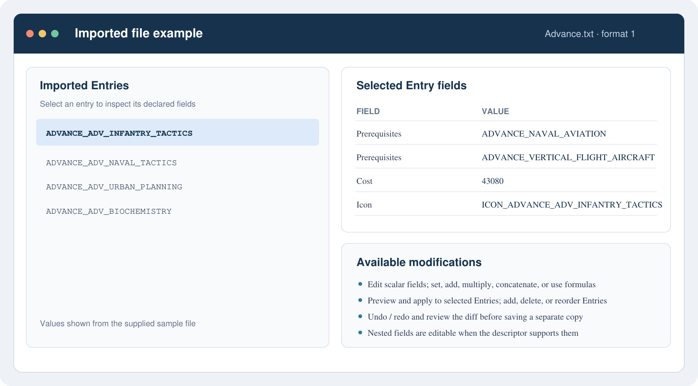

# CTPEd Python port

This project is a visual Python reimplementation of CTPEd, the Civilization: Call to Power 2 data-file editor by John Bytheway. It uses the recovered Ghidra pseudocode, the manual, and the supplied descriptors as behavioral evidence. The export is not the original buildable C source, and Python output parity with CTPEd is still open.

## Run

From this folder:

```powershell
python src/app.py
```

The app uses tkinter and needs a desktop Python installation with Tcl/Tk and a graphical session.

## Windows executable

Download the [Windows x64 distribution](releases/CTPEdPython-Windows-x64.zip), extract the archive, and run `CTPEdPython/CTPEdPython.exe`. Keep the extracted folder together; the executable uses the bundled Python and Tcl/Tk runtime. The bundle is built from `CTPEdPython.spec` with Python 3.10 and PyInstaller 6.22.3.

## Current workflows

### Imported file example

This example uses the supplied `Advance.txt` data and its `advance.ces` structure. Import a declared file, select an Entry to inspect its fields, and make changes in memory before saving a copy.



For a structured file, you can:

- Change an Entry's editable scalar field, such as `Cost`, `Icon`, or `Prerequisites`.
- Add an Entry with descriptor defaults, delete selected Entries, or reorder Entries.
- Apply `set`, `concatenate`, `add`, `multiply`, or formula edits to a field; preview results, target selected Entries, and reference same-file or project data safely.
- Edit schema-bound nested scalar values, or edit a complete raw nested block when its child descriptor is unavailable.
- Undo or redo up to 50 edits and review the Changes diff before saving a separate copy.

Format-0/2 files support direct text editing and exact text replacement; format-0 numeric records also support numeric mass edits. These operations depend on the file format and descriptor, and read-only or unsupported values remain unavailable for editing.

- Choose **Open gamefile…** and select the mod's `gamefile.txt` or prefixed `*_gamefile.txt`; the Windows bundle includes the default `.ced` template and `Structure` descriptors, so no separate `.ced` is needed. The descriptors populate a scrollable **Project files** list without loading all data.
- Select a structured row and choose **Import selected file**, then edit and **Save data file…** to a copy; **Check paths** shows missing files and descriptors.
- Open `.ces` descriptors and inspect fields, flags, defaults, and argument definitions.
- Open `.ced` projects, inspect declarations, choose roots and language, check every resolved data/structure path without importing, and import one selected declaration.
- Open matching data files; view and edit format-0/2 direct text or inspect format-1/3 entries.
- Use the Entries matrix's visible scrollbars to reach every row and field; focus the matrix and press **Ctrl+A** to select all Entries for a selected-only mass edit.
- Add defaulted entries, including nested defaults when child descriptors are available; raw nested-block edits stay outside scalar mass-edit operations.
- Use Ctrl+Z/Ctrl+Y in the active data or settings document; **Changes** shows a read-only diff from the loaded source.
- Save copies of descriptors, projects, preferences, scripts, templates, or supported data-file edits.
- Open `.prf`, `.gls`, and `.glt` files; preview supported Great Library template directives, save a selected Entry render as a CP1252 text copy, and preview the separate unit-icon name template's `%n` shortcut.

Writes remain deferred until the user chooses a save destination. Unsupported schemas or edits surface errors instead of being silently rewritten.

## Local transformation API

The HTTP API is an optional local service; it does not replace or change the Tk editor. Install its separate dependencies and start it from this folder:

```powershell
.venv\Scripts\python.exe -m pip install -r requirements-api.txt
.venv\Scripts\python.exe src/transform_api.py
```

It listens on `127.0.0.1:8765`. Download a blank workbook from `GET /v1/transforms/template`; fill its `Rules` sheet with one row per operation. `StructureFile` must identify a declared `.ces` file, `FieldPath` is the exact field path, `Operation` is `set`, `concatenate`, `add`, `multiply`, or `formula`, and `Operand` is a literal or CTPEd formula expression as text. Rules apply to all Entries, in worksheet order. CTPEd does not evaluate Excel formulas.

Download a QA template from `GET /v1/transforms/qa-template`. Its `CTPEdQA` sheet has one row for each targeted Entry and field; `Expected` must be an Excel formula with a saved cached result. Recalculate and save the workbook in Excel before the run. CTPEd compares these expected values after all rules. Preview can return mismatches; apply refuses to publish an overlay when any value differs.

Send `workbook`, optional `qa_workbook`, `gamefile_path`, `template_path`, and `structure_root` as multipart fields to `POST /v1/transforms/preview` or `POST /v1/transforms/apply`; `language` is optional. Apply also requires a new `output_directory`. Preview writes no files. Apply writes only changed files into a relative-path overlay and leaves the source game files unchanged. Each rule shows an Entry-count `tqdm` bar in the service terminal; progress is not streamed to the browser.

For a QA-gated command-line run, use the same rule and QA workbooks:

```powershell
.venv\Scripts\python.exe src/transform_api.py apply `
  --rules-workbook rules.xlsx `
  --qa-workbook mom-ctpedit-qa.xlsx `
  --gamefile "H:\Program Files(x86)\Activision\Call To Power 2\Scenarios\mom\scen0000\default\gamefile.txt" `
  --template .private_samples/default.ced `
  --structure-root .private_samples/Structure `
  --output-directory mom-ctpedit-overlay
```

The command exits nonzero and creates no output folder on a QA mismatch. The overlay is staged for a generator handoff; CTPEd does not patch the generator-owned scenario directory. See [the API contract](docs/transform_api_spec.md) for the full contract.

## Verify

Run the tests with:

```powershell
python -m pytest -q
```

Tk callback tests skip when the active Python installation lacks Tcl/Tk runtime files. Run `python -m pytest -q` from this folder; `pytest.ini` keeps the archived harness tests out of collection. See [the current plan](docs/plan.md) for coverage and known gaps, and [the operator test plan](docs/test-plan.md) for desktop checks.

